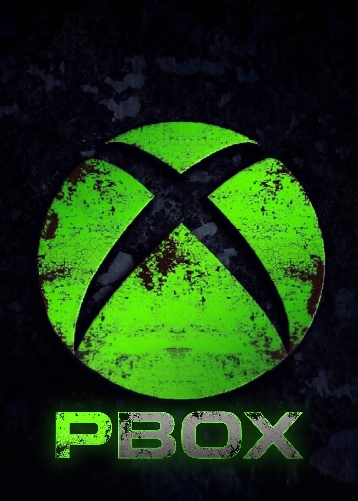

  

<h1 align="center">PBOX</h1>

<strong>Independent PS4 Cloud Gaming Client</strong>

A lightweight native dashboard and streaming client for homebrew-enabled PlayStation 4 systems.

نسخة **PBOX** الخاصة بجهاز **PlayStation 4** لبث ألعاب Xbox السحابية (xCloud)، بإعداد وتطوير وتخصيص **نواف العتيبي (Ravok)**، مبنية فوق الأساس مفتوح المصدر المرخّص تحت **GPL-3.0**.

## حقوق النسخة والتطوير
- **إعداد وتطوير وتخصيص النسخة:** نواف العتيبي (Ravok).
- **الأساس مفتوح المصدر:** مرخّص تحت رخصة **GNU General Public License v3.0 (GPL-3.0)** مع الإبقاء الكامل على ملف [`LICENSE`](LICENSE) وملف [`THIRD_PARTY_NOTICES.md`](THIRD_PARTY_NOTICES.md) وإشعارات المكونات والمكتبات التابعة (`mbedtls`, `libdatachannel`, `FFmpeg`, وغيرها).
- **الشفافية والمصدر:** بما أن المشروع موزع تحت رخصة **GPL-3.0**، فإن الكود المصدري متاح ومفتوح بنفس الرخصة.

## أبرز التخصيصات والاتجاه التطويري
- **تحسين مكتبة الألعاب المشتراة:** متابعة ومعالجة ملكية الألعاب المشتراة (`hasEntitlement` و`alternateProductIds`) في منطق المكتبة وخدمة `gssv` لضمان ظهور الألعاب المملوكة وتشغيلها بسلاسة.
- **تعريب وتجربة مستخدم عربية:** تطوير دعم اللغة العربية والواجهة المخصّصة لمستخدمي PS4.
- **بناء تلقائي لملف `.pkg`:** سير عمل GitHub Actions لبناء حزمة التثبيت الخاصة بـ PS4 وإخراجها مباشرة في Artifacts / Releases.
- **تكامل التطوير مع Manus:** هيكل منظم جاهز لإضافة التحسينات والواجهات والميزات الجديدة خطوة بخطوة.
